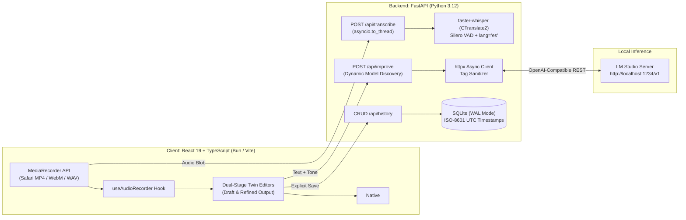

# VoicePrompt

<div align="center">

**Local-First Voice Dictation & AI Text Refinement Engine**

*100% private, zero-cloud speech-to-text with faster-whisper and local LLM prompt engineering via LM Studio.*

[](LICENSE)
[](https://www.python.org/)
[](https://fastapi.tiangolo.com/)
[](https://react.dev/)
[](https://www.typescriptlang.org/)
[](https://bun.sh/)
[](https://vitejs.dev/)
[](backend/tests)

</div>

---

## Overview

**VoicePrompt** is a high-performance, private-by-design productivity workspace. It allows creators, software engineers, and writers to speak freely in Spanish, get real-time local audio transcription via **faster-whisper** (CTranslate2), and instantly polish, restructure, or format their ideas into emails, documents, or structured AI prompts using their local **LM Studio** inference server.

No telemetry. No cloud API costs. No data leaves your machine.

---

## Architecture & Engineering Highlights



### Key Technical Decisions

- **Event Loop Concurrency**: Whisper C++ inference is CPU-bound. Instead of blocking FastAPI's async event loop, transcription runs inside a worker thread pool via `await asyncio.to_thread()`, keeping health checks and concurrent HTTP requests responsive under load.
- **Cross-Browser Audio Demuxing**: Accommodates Safari's non-standard `audio/mp4;codecs=mp4a.40.2` output and Chrome's `audio/webm` via MIME-type container sanitization, avoiding PyAV Matroska demuxing errors.
- **Dynamic Reasoning LLM Sanitization**: Automatically strips `<think>...</think>` traces from modern reasoning models (DeepSeek-R1, QwQ, etc.) and auto-detects currently loaded models via `GET /v1/models`.
- **Zero-Accidental History Bloat**: Drafts remain completely in-memory during editing; data is committed to the local SQLite database only upon explicit user action (*Guardar en historial*).
- **SQLite Write-Ahead Logging (WAL)**: Configured with `PRAGMA journal_mode = WAL` and `PRAGMA synchronous = NORMAL` for resilient local read/write concurrency.
- **Monochrome Soft-UI Design System**: Geometric typography (**Plus Jakarta Sans**), floating pearl-gray canvas (`#E8EAEE`), pill-shaped control surfaces, and twin white editor cards engineered for minimal cognitive load and zero eye fatigue.
- **Web Platform Standards**: Uses native HTML5 `<dialog>` with `.showModal()`, `overscroll-behavior: contain`, and coordinate-validated backdrop dismissal.

---

## Tech Stack

| Domain | Technology | Purpose |
|---|---|---|
| **Speech-to-Text** | `faster-whisper` (CTranslate2) | 4x faster Whisper execution, Silero VAD, int8 quantization |
| **Local LLM Engine** | LM Studio (OpenAI-compatible API) | Local inference for Llama 3, Qwen 2.5, DeepSeek, Mistral, Gemma |
| **Backend Runtime** | Python 3.12 managed via `uv` | Deterministic dependency pinning and sub-second virtual environments |
| **Backend Framework** | FastAPI + Pydantic v2 | High-throughput asynchronous REST API contracts |
| **Persistence** | SQLite (`sqlite3` standard library) | Zero-dependency local persistence with WAL mode |
| **Frontend Framework** | React 19 + TypeScript | Declarative UI state with strict typing |
| **Frontend Tooling** | Bun + Vite | Sub-100ms TypeScript compilation and HMR |
| **Design & Icons** | Vanilla CSS Tokens + Lucide Icons | Accessible, high-contrast monochrome Soft-UI |
| **Code Quality** | Pytest, Bun Test, Oxlint | 35 automated tests covering API contracts, audio formats, and UI logic |

---

## Supported Tone Profiles

VoicePrompt provides 5 tone transformation engines tailored for productivity:

1. **Estándar (`neutral`)**: Natural, balanced, with flawless punctuation and grammar.
2. **Formal (`formal`)**: Academic and executive phrasing with elegant syntax.
3. **Conciso (`concise`)**: Direct to the point, eliminating fluff and redundancies.
4. **Correo (`email`)**: Structured email format complete with Subject line, greeting, body, and closing.
5. **Prompt IA (`prompt`)**: Meta-prompt engineering specifying role, context, goal, and constraints.

---

## Getting Started

### Prerequisites

- [Bun](https://bun.sh/) (`curl -fsSL https://bun.sh/install | bash`)
- [uv](https://docs.astral.sh/uv/) (`curl -LsSf https://astral.sh/uv/install.sh | sh`)
- [LM Studio](https://lmstudio.ai/) with your preferred model downloaded

### 1. Start LM Studio Local Server
1. Launch **LM Studio**.
2. Load any model (e.g. `llama-3.2-3b-instruct`, `qwen2.5-7b-instruct`).
3. Under the **Developer / Local Server** tab, click **Start Server** on port `1234`.

### 2. Backend Setup
```bash
cd backend

# Create virtualenv and install dependencies via uv
uv sync

# Run automated tests
uv run pytest

# Start development server
uv run uvicorn app.main:app --reload --port 8000
```
Backend API will be live at `http://localhost:8000` (interactive OpenAPI documentation at `http://localhost:8000/docs`).

### 3. Frontend Setup
```bash
cd frontend

# Install dependencies via Bun
bun install

# Run unit tests and linter
bun test
bun run lint

# Start Vite dev server
bun run dev
```
Open your browser at `http://localhost:5173`.

---

## Automated Verification & Testing

The project maintains 100% passing automated test coverage across both layers:

```bash
# Backend pytest suite (23 tests)
cd backend && uv run pytest -v

# Frontend bun test suite (12 tests) + production build
cd frontend && bun test && bun run build
```

---

## License

This project is licensed under the [MIT License](LICENSE) - feel free to use, modify, and distribute for personal or commercial projects.
