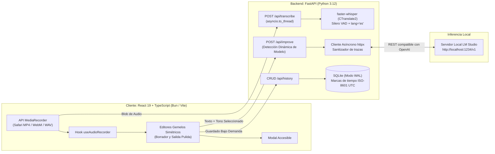

# VoicePrompt

<div align="center">

**Motor Local de Dictado por Voz y Refinamiento de Texto con IA**

*Transcripción de voz a texto 100% privada con faster-whisper e ingeniería de prompts local mediante LM Studio.*

[](LICENSE)
[](https://www.python.org/)
[](https://fastapi.tiangolo.com/)
[](https://react.dev/)
[](https://www.typescriptlang.org/)
[](https://bun.sh/)
[](https://vitejs.dev/)
[](backend/tests)

</div>

---

## Descripción General

**VoicePrompt** es un espacio de trabajo productivo diseñado bajo el principio de **privacidad absoluta y ejecución local**. Permite a desarrolladores, creadores y redactores dictar libremente sus ideas en español con su micrófono, obtener una transcripción precisa e instantánea usando **faster-whisper** (CTranslate2), y reestructurar o transformar el texto en correos ejecutivos, documentos o *prompts* técnicos utilizando cualquier modelo de lenguaje grande (LLM) ejecutado en local a través de **LM Studio**.

Sin telemetría. Sin costos de APIs en la nube. Ningún dato sale de tu ordenador.

---

## Arquitectura y Decisiones de Ingeniería



### Decisiones Técnicas Clave

- **Concurrencia sin bloqueo del Event Loop**: La inferencia en C++ de Whisper consume intensamente CPU. En lugar de bloquear el bucle de eventos asíncrono de FastAPI, el procesamiento de audio se delega a un hilo de ejecución independiente con `await asyncio.to_thread()`, manteniendo las comprobaciones de salud (*health checks*) y peticiones concurrentes 100% fluidas.
- **Demuxing robusto multi-navegador**: Se gestionan las peculiaridades de Safari (que graba en `audio/mp4;codecs=mp4a.40.2`) frente a Chromium (`audio/webm`), normalizando la extensión del contenedor temporal antes de enviarlo a PyAV para evitar fallos de demuxing en tiempo de ejecución.
- **Sanitización de Modelos de Razonamiento**: Para modelos como DeepSeek-R1 o QwQ, el cliente backend detecta y remueve automáticamente los bloques internos de pensamiento (`<think>...</think>`), entregando al usuario únicamente el texto final refinado.
- **Autodescubrimiento de Modelo**: Consulta dinámicamente `/v1/models` en LM Studio para vincularse al modelo actualmente cargado en memoria, eliminando la necesidad de reconfigurar archivos `.env` al cambiar de LLM.
- **Persistencia Responsable (Cero Basura en Base de Datos)**: Los borradores permanecen en la memoria del cliente mientras se editan; la base de datos SQLite solo almacena un registro cuando el usuario hace clic expresamente en *Guardar en historial*.
- **SQLite en Modo WAL**: Configurado con `PRAGMA journal_mode = WAL` y `PRAGMA synchronous = NORMAL`, lo que asegura lecturas y escrituras concurrentes de alta velocidad sin bloqueos de archivo.
- **Sistema de Diseño Soft-UI Monocromático**: Tipografía geométrica (**Plus Jakarta Sans**), lienzo gris perla (`#E8EAEE`), componentes en cápsula (*pills*) y dos tarjetas gemelas blancas que eliminan la fatiga visual al comparar textos.
- **Estándares Web Nativos**: Empleo del elemento `<dialog>` con `.showModal()`, `overscroll-behavior: contain` para prevenir el scroll del fondo, y validación de coordenadas para descarte al hacer clic en el backdrop.

---

## Stack Tecnológico

| Área | Tecnología | Justificación Técnica |
|---|---|---|
| **Voz a Texto (STT)** | `faster-whisper` (CTranslate2) | 4x más rápido que Whisper original, filtro VAD Silero y cuantización int8 |
| **Motor LLM Local** | LM Studio (API compatible con OpenAI) | Inferencia local sin costes para Llama 3, Qwen 2.5, DeepSeek, Mistral, Gemma |
| **Entorno Backend** | Python 3.12 gestionado con `uv` | Entornos virtuales en milisegundos y dependencias binarias precompiladas |
| **Framework Backend** | FastAPI + Pydantic v2 | Validación estricta de esquemas y endpoints asíncronos de alto rendimiento |
| **Base de Datos** | SQLite (`sqlite3` estándar) | Cero configuración externa, portabilidad total y modo WAL activado |
| **Framework Frontend** | React 19 + TypeScript | Tipado estricto extremo a extremo y gestión de estado declarativa |
| **Herramientas Frontend** | Bun + Vite | Compilación de TypeScript y Hot Module Replacement en menos de 100 ms |
| **Diseño e Iconografía** | Tokens CSS nativos + Lucide Icons | Estética Soft-UI moderna, ligera, sin dependencias pesadas de estilos |
| **Calidad y Pruebas** | Pytest, Bun Test, Oxlint | 35 pruebas automatizadas entre endpoints, codecs de audio y lógica cliente |

---

## Perfiles de Tono Soportados

VoicePrompt incluye 5 modos de transformación configurados con prompts de sistema optimizados:

1. **Estándar (`neutral`)**: Redacción natural, fluida, con ortografía y puntuación impecables.
2. **Formal (`formal`)**: Registro ejecutivo y académico, con vocabulario preciso y sintaxis elegante.
3. **Conciso (`concise`)**: Mensaje directo al grano, eliminando muletillas, relleno y redundancias.
4. **Correo (`email`)**: Estructura lista para enviar, con asunto sugerido, saludo cordial, cuerpo y despedida profesional.
5. **Prompt IA (`prompt`)**: Meta-ingeniería de instrucciones, estructurando la idea en rol, contexto, tarea y restricciones.

---

## Puesta en Marcha Local

### Prerrequisitos

- [Bun](https://bun.sh/) (`curl -fsSL https://bun.sh/install | bash`)
- [uv](https://docs.astral.sh/uv/) (`curl -LsSf https://astral.sh/uv/install.sh | sh`)
- [LM Studio](https://lmstudio.ai/) con cualquier modelo descargado

### 1. Iniciar el Servidor de LM Studio
1. Abre **LM Studio**.
2. Carga un modelo en memoria (ejemplo: `llama-3.2-3b-instruct` o `qwen2.5-7b-instruct`).
3. En la pestaña **Developer / Local Server**, haz clic en **Start Server** en el puerto `1234`.

### 2. Configurar el Backend
```bash
cd backend

# Sincronizar dependencias con uv
uv sync

# Ejecutar la suite de pruebas
uv run pytest

# Iniciar el servidor de desarrollo
uv run uvicorn app.main:app --reload --port 8000
```
La API estará disponible en `http://localhost:8000` (documentación interactiva en `http://localhost:8000/docs`).

### 3. Configurar el Frontend
```bash
cd frontend

# Instalar dependencias con Bun
bun install

# Ejecutar pruebas unitarias y análisis estático
bun test
bun run lint

# Iniciar servidor de desarrollo con Vite
bun run dev
```
Abre tu navegador en `http://localhost:5173`.

---

## Verificación y Calidad de Código

El repositorio cuenta con una cobertura completa de pruebas automatizadas:

```bash
# Pruebas del Backend con pytest (23 pruebas)
cd backend && uv run pytest -v

# Pruebas del Frontend con Bun Test (12 pruebas) y compilación de producción
cd frontend && bun test && bun run build
```

---

## Licencia

Este proyecto está bajo la [Licencia MIT](LICENSE) — eres libre de utilizarlo, modificarlo y distribuirlo para fines personales o comerciales.
